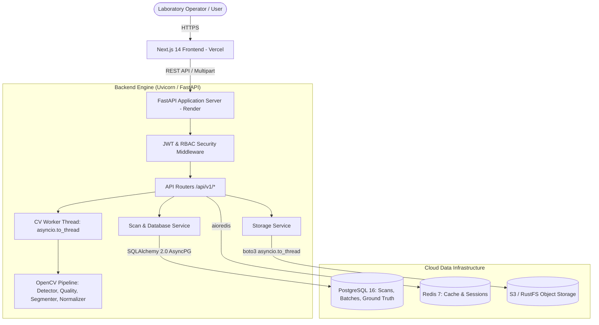

# EggVision AI 🥚
**Scientific Non-Destructive Poultry Egg Quality Research & Candling Capture Platform**

[](docs/EGGVISION_TEST_AND_VALIDATION_REPORT.md)
[](docs/EGGVISION_TEST_AND_VALIDATION_REPORT.md)
[](LICENSE)
[](backend/requirements.txt)
[](frontend/package.json)
[](docs/EGGVISION_MODEL_CARD.md)

---

## 1. Project Overview

**EggVision AI** is an open-source, full-stack, scientifically grounded platform designed for controlled optical imaging, computer-vision capture screening, and longitudinal research on poultry eggs.

### What EggVision Does Today
- **Controlled Optical Screening:** Implements deterministic OpenCV algorithms (`ml/vision/`) supporting both dark-chamber transillumination candling and diffuse general surface imaging.
- **Candidate Contour Geometry:** Evaluates candidate contour area, bounding dimensions, aspect ratio, orientation angle, and centroid.
- **Region-of-Interest Quality Gating:** Measures blur (Laplacian variance), candidate glare, deep shadow ratio, border clipping, and resolution within the candidate ROI.
- **Canonical Optical Normalization:** Standardizes captures to vertically aligned $512 \times 512$ CLAHE-enhanced image artifacts.
- **Transactional Research Archival:** Persists linked image artifacts, environmental sensor readings (temperature, humidity), batch counts, and destructive ground-truth laboratory measurements (Haugh units, albumen height, yolk index, pH) in PostgreSQL via atomic transactions.
- **Zero Hallucination AI Transparency:** Deliberately reports `MODEL_NOT_READY` (`is_ready() == False`) via `PlaceholderEngine` until a real, empirically validated neural network checkpoint is trained against verified ground truth.

### What EggVision Does NOT Do
- It **does not** generate synthetic or fake AI predictions, confidence percentages, or freshness classifications.
- It **does not** claim to detect microbiological pathogens (*Salmonella enteritidis*, *E. coli*) or certify food safety.

---

## 2. System Architecture



---

## 3. Technology Stack

| Domain | Technologies & Libraries |
| :--- | :--- |
| **Frontend Application** | Next.js 14 (App Router), React 18, TypeScript, Tailwind CSS, Radix UI (`shadcn/ui`), Lucide Icons |
| **Backend Web Service** | FastAPI 0.110+, Uvicorn, Pydantic V2, Starlette, Python 3.12 |
| **Database & Caching** | PostgreSQL 16, SQLAlchemy 2.0 (AsyncPG), Alembic 1.13+, Redis 7 (`redis-py`) |
| **Vision & Image Processing**| OpenCV 4.9+ (`opencv-python-headless`), NumPy, Pillow, Scikit-Image |
| **Authentication & Security**| JWT (`python-jose`), Pinned Passlib 1.7.4 + Bcrypt 4.0.1, Cryptographic Request Correlation IDs |
| **Deployment Targets** | Vercel (Edge CDN Frontend), Render (Dockerized Web Service & Managed DB), Docker Compose |

---

## 4. Documentation Index

The repository contains comprehensive engineering specifications in the [`docs/`](docs/) directory:

1. [System Architecture Specification](docs/EGGVISION_SYSTEM_ARCHITECTURE.md)
2. [Scientific Feasibility & Literature Review](docs/EGGVISION_SCIENTIFIC_FEASIBILITY.md)
3. [Optical Hardware Enclosure & BOM](docs/EGGVISION_OPTICAL_HARDWARE_DESIGN.md)
4. [Dataset Architecture & Ground Truth Protocol](docs/EGGVISION_DATASET_AND_GROUND_TRUTH.md)
5. [Computer Vision & ML Pipeline Design](docs/EGGVISION_CV_AND_ML_DESIGN.md)
6. [Complete REST API Reference Manual](docs/EGGVISION_API_REFERENCE.md)
7. [Database Schema & Alembic Migrations](docs/EGGVISION_DATABASE_AND_MIGRATIONS.md)
8. [Cybersecurity Assessment & Hardening](docs/EGGVISION_SECURITY_REVIEW.md)
9. [Production Deployment Guide (Render & Vercel)](docs/EGGVISION_DEPLOYMENT_GUIDE.md)
10. [Comprehensive Test & Validation Report](docs/EGGVISION_TEST_AND_VALIDATION_REPORT.md)
11. [Operator & Researcher User Guide](docs/EGGVISION_USER_GUIDE.md)
12. [System Administrator & Operations Manual](docs/EGGVISION_ADMIN_GUIDE.md)
13. [Machine Learning Model Card](docs/EGGVISION_MODEL_CARD.md)
14. [Remaining Engineering Work & Punchlist](docs/EGGVISION_REMAINING_WORK.md)

---

## 5. Quick Start & Local Execution

### 5.1 Option A: Local Full-Stack with Docker Compose
```bash
# Clone the repository
git clone https://github.com/Rishit-ui/eggVision.git
cd eggVision

# Configure environment
cp .env.example .env

# Start all 5 container services (Frontend, Backend, PostgreSQL, Redis, MinIO/RustFS)
docker compose up -d --build
```
- **Web UI:** `http://localhost:3000`
- **Interactive API Docs:** `http://localhost:8000/docs`

### 5.2 Option B: Local Development Shell
#### Backend (Python 3.12)
```bash
cd backend
python -m venv .venv
source .venv/bin/activate  # On Windows: .venv\Scripts\Activate.ps1
pip install -r requirements.txt -r ../ml/requirements.txt
alembic upgrade head
python -m uvicorn app.main:app --reload --port 8000
```

#### Frontend (Node.js 20)
```bash
cd frontend
npm install
npm run dev
```

---

## 6. Running Test Suites

```bash
# Set PYTHONPATH
export PYTHONPATH="$PWD/backend:$PWD"  # On Windows: $env:PYTHONPATH = "$PWD\backend;$PWD"

# 1. Dependency integrity check
python -m pip check

# 2. Run backend and CV test suite (50 tests)
pytest tests -q

# 3. Frontend lint, type-check, and production build
cd frontend
npm run lint
npm run type-check
npm run build
```

---

## 7. Production Deployments

- **Production Frontend:** `https://egg-vision.vercel.app` (Hosted on Vercel)
- **Production API:** `https://eggvision-1.onrender.com/api/v1` (Hosted on Render)
- **Deep Health Check:** `https://eggvision-1.onrender.com/api/v1/health`
- **API Documentation:** `https://eggvision-1.onrender.com/docs`

---

## 8. License & Scientific Disclaimer

This project is licensed under the **MIT License** — see the [LICENSE](LICENSE) file for details.

> [!WARNING]
> **Food Safety Disclaimer:** EggVision AI is an experimental scientific research instrument. It does not provide medical, veterinary, or legal food-safety certification. Optical screening cannot detect microscopic microbial contamination (*Salmonella*, *Campylobacter*) in intact eggs. Never consume eggs that exhibit foul odor, discolored albumen, or visible structural spoilage regardless of any visual score.
