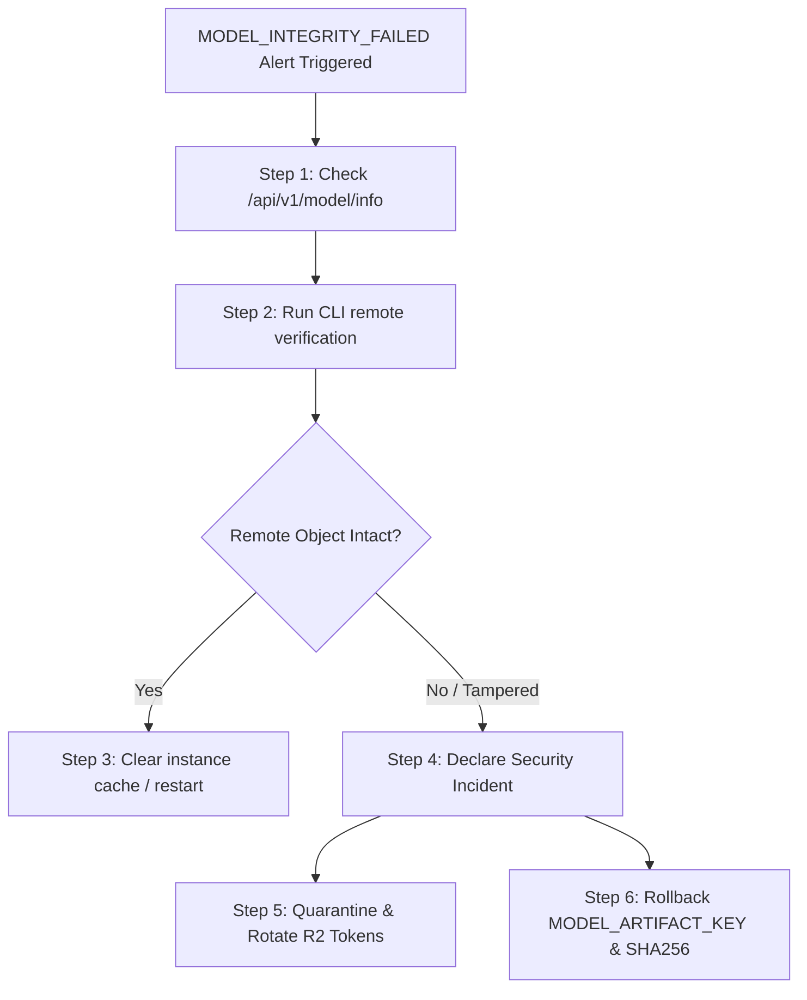

# EggVision Artifact Security & Tamper Detection Runbook

This operational runbook provides security guidelines, incident response procedures, and audit commands for detecting and remediating model artifact tampering in production.

---

## 1. Threat Model & Safeguards

| Threat Vector | Mechanism | Protection Implemented |
| :--- | :--- | :--- |
| **Tampered / Injected Model Binary** | Attacker modifies weights on R2 or intercepts S3 transfer | Strict 64-character SHA-256 pre-execution validation with constant-time comparison |
| **Model Inversion / Side-Channel** | Attacker infers hash matching time | `hmac.compare_digest` prevents timing attacks |
| **Server Crash via Memory Exhaustion** | PyTorch loaded into a constrained container | Production environment rejects `.pt` models unconditionally |
| **Credential Bleed / Privilege Escalation** | Model loader reuses user storage credentials | Complete isolation between `MODEL_S3_*` and `S3_*` namespaces |
| **Local Path Traversal** | Manipulated model path accesses system files | Absolute resolution with strict validation; telemetry sanitization |

---

## 2. Integrity Incident Alert: `MODEL_INTEGRITY_FAILED`

### Symptoms & Health Status
- **Endpoint `/api/v1/health`:**
  - Status: `DEGRADED`
  - Component: `"model_service": "NOT_READY"`
- **Endpoint `/api/v1/model/info`:**
  - `state`: `"MODEL_INTEGRITY_FAILED"`
  - `is_ready`: `false`
  - `checksum_verified`: `false`
  - `failure_reason`: `"Artifact SHA-256 mismatch: expected ..., got ..."`
- **Endpoint `/api/v1/predict`:**
  - Rejects live inference with safe `PlaceholderEngine` status.

---

## 3. Immediate Incident Response Procedure



### Step 1: Query Production Diagnostics

Query the production model status:
```bash
curl -s https://eggvision-1.onrender.com/api/v1/model/info | jq
```

Inspect the `failure_reason` and compare `expected_sha256` vs `computed_sha256`.

### Step 2: Validate Remote Model Integrity

Run the verification script against R2 directly:
```powershell
python ml/scripts/verify_model_artifact.py `
  --remote-key "eggvision/detection/v1/81ee288a717ce922d195399244678d94596a6fab3adc4fc8a2eb46abf25678c1/model.onnx" `
  --expected-sha "81ee288a717ce922d195399244678d94596a6fab3adc4fc8a2eb46abf25678c1"
```

### Step 3: Resolution If Remote Object is Intact (Transient Network Corruption)
1. In the Render Dashboard, trigger a **Manual Deploy > Clear build cache & deploy**.
2. Render container restart will spin up a fresh ephemeral disk, downloading the model into `/tmp/eggvision_models/<sha256>/model.onnx`.

### Step 4: Resolution If Remote Object is Tampered
1. **Immediate Revocation:** In Cloudflare Dashboard, revoke the compromised R2 API tokens immediately.
2. **Bucket Audit:** Inspect Cloudflare R2 audit logs for unauthorized `PutObject` operations.
3. **Re-publish Known-Good Checksum:**
   ```powershell
   python ml/scripts/publish_model_artifact.py `
     --onnx-path ml/artifacts/detection/weights/eggvision_detector.onnx `
     --metadata-path ml/artifacts/detection/onnx_metadata.json `
     --equivalence-report-path ml/artifacts/detection/onnx_equivalence_report.json `
     --version v1
   ```
4. **Update Render Environment:** Generate fresh read-only tokens and update `MODEL_S3_ACCESS_KEY` and `MODEL_S3_SECRET_KEY` on Render.
