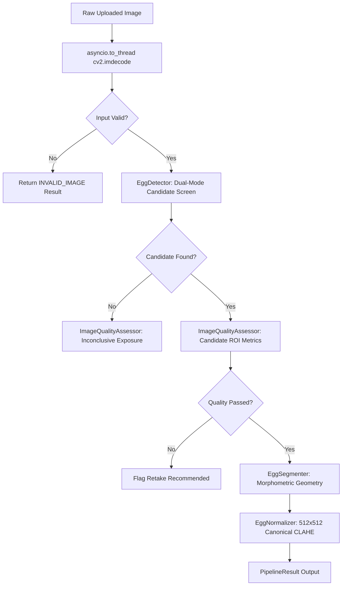

# EggVision AI — Computer Vision & Machine Learning Pipeline Design
**Document Version:** 1.0.0  
**Classification:** Technical Architecture & Algorithm Specification  
**Subject:** Deterministic Optical Screening, Morphometrics, and Scientific Machine Learning Framework

---

## 1. Computer Vision Pipeline Architecture

The EggVision computer vision subsystem (`ml/vision/`) is designed as a deterministic, modular pipeline. It processes raw BGR image frames and generates validated candidate regions, morphometric measurements, optical quality metrics, and canonical normalized image artifacts.



---

## 2. Mathematical & Algorithmic Specifications

### 2.1 Dual-Mode Candidate Screening (`detector.py`)
EggVision supports two distinct acquisition environments:

#### Mode A: Controlled Candling (`controlled_candling`)
In a dark scanning chamber, the background border pixels exhibit low luminance ($L^* < 25$). Foreground candidate extraction utilizes adaptive Otsu thresholding:
$$\sigma_w^2(t) = \omega_0(t)\sigma_0^2(t) + \omega_1(t)\sigma_1^2(t)$$
Where $t^*$ minimizes within-class intensity variance between foreground egg candidate and chamber backdrop.

#### Mode B: General Photograph (`general_photograph`)
For eggs photographed against light, neutral, or non-candling backgrounds, Otsu thresholding fails. The system computes the Euclidean color distance in CIELAB color space relative to the border background color:
$$\Delta E_{ab}^* = \sqrt{(\Delta L^*)^2 + (\Delta a^*)^2 + (\Delta b^*)^2}$$
Morphological closing with an elliptical structuring element ($11 \times 11$) bridges perimeter gaps before external contour tracing (`cv2.findContours`).

#### Candidate Contour Gating Rules
A contour is retained as an optical candidate **only** if it satisfies the physical constraints in `ScreeningThresholds`:
- **Area Fraction:** $0.04 \le \frac{\text{Contour Area}}{\text{Frame Area}} \le 0.92$
- **Aspect Ratio:** $1.05 \le \frac{\text{Major Axis}}{\text{Minor Axis}} \le 2.20$ (ruling out circular coins or elongated tubes)
- **Solidity:** $\frac{\text{Contour Area}}{\text{Convex Hull Area}} \ge 0.88$ (ruling out concave, branching, or highly irregular objects)

### 2.2 Region-of-Interest (ROI) Quality Assessment (`quality.py`)
Quality metrics are evaluated **exclusively inside the candidate bounding box or contour mask**, preventing background brightness from skewing egg measurements:

1. **Blur Detection (Laplacian Variance):**
   $$\text{Blur Metric} = \text{Var}\left(\nabla^2 I_{\text{ROI}}\right) = \frac{1}{N}\sum (L(x,y) - \mu_L)^2$$
   If $\text{Var} < 100.0$, the image is flagged with `BLUR_DETECTED`.
2. **Candidate Glare Analysis:**
   $$\text{Glare Fraction} = \frac{\sum_{(x,y) \in \text{ROI}} [I(x,y) \ge 250]}{\text{Total ROI Pixels}}$$
   If $\text{Glare Fraction} > 0.08$, flagged with `EXCESSIVE_CANDIDATE_GLARE`.
3. **Shadow & Underexposure:**
   $$\text{Shadow Fraction} = \frac{\sum_{(x,y) \in \text{ROI}} [I(x,y) \le 30]}{\text{Total ROI Pixels}}$$
   If $\text{Shadow Fraction} > 0.35$, flagged with `STRONG_CANDIDATE_SHADOWS`.
4. **Border Clipping / Framing Margin:**
   If candidate bounding box boundaries intersect the outer $2\%$ margin of the camera frame, flagged with `CANDIDATE_PARTIALLY_VISIBLE_BORDER_CLIPPED`.

### 2.3 Morphometric Feature Extraction (`segmentation.py`)
For validated candidates, second-order image central moments determine physical orientation and geometry:
$$\mu_{pq} = \sum_{x}\sum_{y} (x - \bar{x})^p (y - \bar{y})^q I(x,y)$$
- **Principal Axis Orientation ($\theta$):**
  $$\theta = \frac{1}{2} \arctan\left( \frac{2\mu_{11}}{\mu_{20} - \mu_{02}} \right)$$
- **Fitted Bounding Ellipse:** Yields semi-major axis $a$, semi-minor axis $b$, and eccentricity $e = \sqrt{1 - (b/a)^2}$.

### 2.4 Canonical Image Normalization (`normalizer.py`)
To prepare raw captures for standardized downstream machine learning:
1. **Affine Rotation:** The candidate is rotated by $-\theta$ to align the principal axis vertically with the blunt pole upwards.
2. **Padded Aspect-Preserving Crop:** The candidate ROI is cropped with a $15\%$ contextual border.
3. **Bilinear Resampling:** Resized to a standardized canonical resolution of $512 \times 512$ pixels.
4. **Contrast Enhancement:** Converted to LAB color space; Contrast Limited Adaptive Histogram Equalization (CLAHE, `clipLimit=2.0`, `tileGridSize=(8,8)`) is applied to the L-channel to reveal internal air cell boundaries through dense shell pigmentation.

---

## 3. Machine Learning Architecture Roadmap

```
                    ┌──────────────────────────────────────────────┐
                    │       Normalized 512x512 Image (CLAHE)       │
                    └──────────────────────┬───────────────────────┘
                                           │
                    ┌──────────────────────┴───────────────────────┐
                    ▼                                              ▼
    [ Sub-Network A: Segmentation ]                [ Sub-Network B: Feature Backbone ]
         U-Net (ResNet-34 Encoder)                   EfficientNet-B0 (Pretrained)
                    │                                              │
                    ▼                                              ▼
        Air Cell Silhouette Mask                       256-D Optical Embedding Vector
                    │                                              │
                    ▼                                              │
     Air Cell Projected Ratio (A_air / A_egg)                      │
                    │                                              │
                    └──────────────────────┬───────────────────────┘
                                           │
                                           ▼
                    ┌──────────────────────────────────────────────┐
                    │        Multimodal Feature Fusion Gate        │
                    │ - Air Cell Ratio                             │
                    │ - 256-D Visual Embedding                     │
                    │ - Storage Temperature (°C)                   │
                    │ - Relative Humidity (%)                      │
                    │ - Storage Duration (Days)                    │
                    └──────────────────────┬───────────────────────┘
                                           │
                    ┌──────────────────────┴───────────────────────┐
                    ▼                                              ▼
         [ Regression Head ]                             [ Classification Head ]
          XGBoost / MLP Regressor                         Softmax Classifier
                    │                                              │
                    ▼                                              ▼
         Predicted Haugh Unit (HU)                        USDA Grade (AA, A, B)
```

### 3.1 Model Decomposition
1. **Segmentation Sub-Network:** U-Net architecture trained with Binary Cross-Entropy + Dice Loss to segment the air cell boundary under transillumination.
2. **Feature Extraction Backbone:** Lightweight EfficientNet-B0 backbone extracting spatial density features.
3. **Multimodal Fusion Regressor:** Gradient-boosted decision trees (XGBoost) combining optical air-cell ratio with temperature and humidity logs to predict Haugh Unit ($HU$) directly.

### 3.2 Transparent Model Lifecycle & Gating
- In current production builds, `PlaceholderEngine` implements the `InferenceEngine` interface and strictly returns `MODEL_NOT_READY`.
- No model checkpoint may be registered without a signed Model Card verifying independent test set evaluation ($n \ge 358$ eggs), 5-fold cross-validation, and calibrated confidence intervals.
