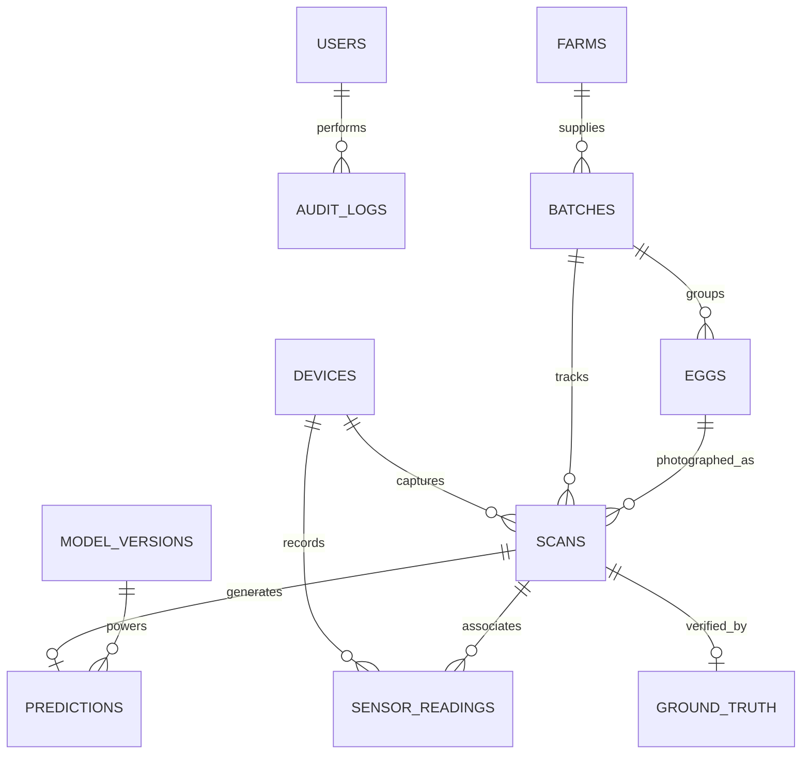

# EggVision AI — Database Schema & Alembic Migration Specification
**Document Version:** 1.0.0  
**RDBMS:** PostgreSQL 16  
**ORM / Migration Engine:** SQLAlchemy 2.0 (AsyncPG) + Alembic 1.13+

---

## 1. Relational Database Schema Overview

The EggVision PostgreSQL database manages user authentication, equipment device records, poultry farm suppliers, egg batch lifecycles, physical egg specimens, scan captures, optical sensor telemetry, destructive ground-truth laboratory measurements, and system audit logs.



---

## 2. Table Definitions & Column Specifications

### 2.1 `users`
Manages system accounts, hashed credentials, and role-based access control.
- `id` (UUID, Primary Key, default `uuid4`)
- `email` (VARCHAR(255), Unique, Not Null, Indexed)
- `hashed_password` (VARCHAR(255), Not Null) — bcrypt hash
- `full_name` (VARCHAR(255), Nullable)
- `role` (VARCHAR(50), Not Null, default `'user'`) — `'admin'`, `'researcher'`, `'user'`
- `is_active` (BOOLEAN, Not Null, default `true`)
- `created_at` (TIMESTAMPTZ, server_default `now()`)
- `updated_at` (TIMESTAMPTZ, server_default `now()`)

### 2.2 `farms` & `batches`
Tracks poultry suppliers and harvest batches.
- **`farms`**: `id` (UUID, PK), `name` (VARCHAR), `location` (VARCHAR), `flock_type` (VARCHAR), `created_at` (TIMESTAMPTZ).
- **`batches`**: `id` (UUID, PK), `batch_code` (VARCHAR(100), Unique, Indexed), `farm_id` (UUID, FK -> `farms.id`), `total_eggs` (INTEGER), `scanned_eggs` (INTEGER, default 0), `status` (VARCHAR, default `'pending'`), `created_at` (TIMESTAMPTZ).

### 2.3 `eggs` & `scans`
The core entities linking physical eggs to image captures.
- **`eggs`**: `id` (UUID, PK), `batch_id` (UUID, FK -> `batches.id`), `egg_number` (INTEGER), `shell_color` (VARCHAR), `created_at` (TIMESTAMPTZ).
- **`scans`**:
  - `id` (UUID, Primary Key)
  - `egg_id` (UUID, FK -> `eggs.id`, Nullable, Indexed)
  - `batch_id` (UUID, FK -> `batches.id`, Nullable, Indexed)
  - `device_id` (UUID, FK -> `devices.id`, Nullable)
  - `original_image_url` (VARCHAR, Nullable) — Storage path
  - `processed_image_url` (VARCHAR, Nullable) — Normalized CLAHE artifact path
  - `image_quality` (VARCHAR, Nullable) — `'GOOD'`, `'ACCEPTABLE'`, `'POOR'`
  - `image_quality_score` (FLOAT, Nullable) — Deprecated persistence field (always null)
  - `image_quality_warnings` (JSONB, default `[]`) — List of warning codes
  - `camera_metadata` (JSONB, Nullable) — Candidate contour geometry, optical metrics, capture context
  - `capture_date` (TIMESTAMPTZ, default `now()`)
  - `created_at` (TIMESTAMPTZ, server_default `now()`, Indexed)

### 2.4 `predictions` & `model_versions`
Inference outputs linked to specific scan captures and versioned models.
- **`predictions`**:
  - `id` (UUID, Primary Key)
  - `scan_id` (UUID, FK -> `scans.id`, Unique, Indexed)
  - `model_version_id` (UUID, FK -> `model_versions.id`, Nullable)
  - `freshness_class` (VARCHAR, Nullable)
  - `freshness_score` (FLOAT, Nullable)
  - `predicted_haugh_unit` (FLOAT, Nullable)
  - `confidence` (FLOAT, Nullable)
  - `air_cell_area` (FLOAT, Nullable)
  - `air_cell_ratio` (FLOAT, Nullable)
  - `status` (VARCHAR, default `'model_not_ready'`)
  - `explanation` (JSONB, Nullable)
  - `created_at` (TIMESTAMPTZ, server_default `now()`)

### 2.5 `ground_truth` & `sensor_readings`
Verification telemetry and destructive reference metrics.
- **`ground_truth`**: `id` (UUID, PK), `scan_id` (UUID, FK -> `scans.id`, Unique), `egg_id` (UUID, FK -> `eggs.id`), `actual_haugh_unit` (FLOAT), `actual_albumen_height_mm` (FLOAT), `actual_yolk_index` (FLOAT), `actual_ph` (FLOAT), `actual_grade` (VARCHAR), `verified_by` (VARCHAR), `measured_at` (TIMESTAMPTZ).
- **`sensor_readings`**: `id` (UUID, PK), `scan_id` (UUID, FK -> `scans.id`, Indexed), `device_id` (UUID, FK -> `devices.id`), `temperature` (FLOAT), `humidity` (FLOAT), `ambient_light_lux` (FLOAT), `recorded_at` (TIMESTAMPTZ).

---

## 3. Alembic Migration Strategy & Operational Rules

### 3.1 Migration Revision Invariants
1. **Single Head Revision:** All production tables are managed under `001_initial_schema.py`. The migration history forms an unbroken linear directed acyclic graph (DAG).
2. **Reversible Operations:** Schema modifications must provide explicit `upgrade()` and `downgrade()` routines.
3. **Non-Destructive Deployments:** Under no circumstances should `Base.metadata.drop_all()` be invoked in deployment code or migration scripts. Dropping tables destroys live research data.
4. **Automated Startup Migration:** The deployment script (`scripts/start_render_backend.sh`) executes `alembic upgrade head` before Uvicorn binds to the network port. If migration fails, the container aborts immediately, preventing an inconsistent application state.

### 3.2 SQLAlchemy Async Connection Pool Configuration
In `backend/app/database.py`, the engine is instantiated with robust connection parameters:
```python
engine = create_async_engine(
    settings.DATABASE_URL,
    pool_size=10,
    max_overflow=20,
    pool_recycle=300,
    pool_pre_ping=True,
    echo=settings.DEBUG,
)
```
- `pool_pre_ping=True`: Tests connections with `SELECT 1` prior to checkout, transparently discarding connections terminated by cloud firewalls or Render idle timeouts.
- `pool_recycle=300`: Refreshes connections every 5 minutes to prevent stale socket states.
