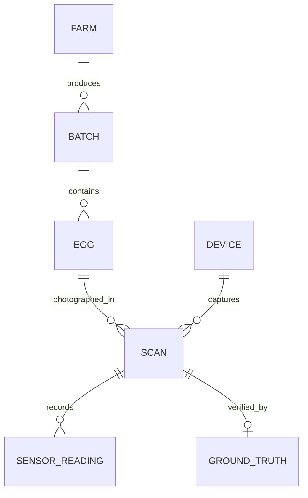

# EggVision AI — Dataset Architecture & Ground Truth Protocol
**Document Version:** 1.0.0  
**Classification:** Research Methodology & Dataset Engineering  
**Subject:** Longitudinal Capture Protocol, Experimental Ground Truth Linkage, and Data Leakage Prevention

---

## 1. Audit of Existing Public Egg Datasets & Literature Limitations

A critical audit of publicly accessible poultry egg imaging datasets (Kaggle, Mendeley Data, Zenodo, Roboflow) reveals profound scientific limitations that prevent them from supporting valid freshness or internal quality models:

| Dataset / Source | Stated Goal | Image Count | Ground Truth Labels | Major Scientific Flaw / Risk |
| :--- | :--- | :--- | :--- | :--- |
| **Kaggle Egg Quality / Freshness** | Freshness Classification | ~1,500 | "Fresh" vs "Spoiled" (binary) | **No physical ground truth.** Labels assigned subjectively based on storage days without Haugh Unit or breakout measurements. High data leakage (multiple images of same egg in train/test). |
| **Mendeley Egg Shell Defect** | Shell Defect Screening | ~2,200 | Crack, Blood, Dirty, Normal | Useful for surface classification; completely unlinked to internal freshness, albumen height, or storage temperature logs. |
| **Roboflow Egg Candling Sets** | Candling Detection | ~400 | Bounding boxes | Variable uncontrolled mobile phone lighting; no ambient light exclusion; uncalibrated optical scale. |

### Conclusion
No publicly accessible dataset links controlled transillumination and reflectance images of intact eggs directly to destructive biochemical gold standards (albumen height, Haugh unit, yolk index, pH) with complete environmental tracking. EggVision AI must establish its own reproducible laboratory dataset protocol.

---

## 2. EggVision Unique Physical Entity Data Model

Every physical egg entering the EggVision research pipeline is assigned an immutable universally unique identifier (`egg_id: UUIDv4`). All subsequent digital artifacts and laboratory measurements link back to this single physical specimen.



### 2.1 Sample Tracking Schema & Attributes
- **Origin Metadata:** Farm ID, flock breed, flock age (weeks), lay date/time, collection date/time.
- **Physical Characteristics:** Initial mass at collection ($g$, $\pm 0.01\,g$), shell color (white, brown, tinted, native/desi).
- **Storage Profile:** Storage condition (`refrigerated` $4^\circ\text{C}$, `ambient_cool` $15^\circ\text{C}$, `room_temp` $22^\circ\text{C}$, `incubated` $37.5^\circ\text{C}$), ambient relative humidity ($30–90\%$), storage duration (hours / days).
- **Capture Metadata:** Device UUID, chamber serial, camera sensor model, exposure time, optical gain, illumination PWM setting, capture timestamp.
- **Image Artifacts:** Original raw image URI, segmented mask URI, normalized $512 \times 512$ artifact URI, optical quality metric dictionary.

---

## 3. Destructive Ground Truth Laboratory Protocol

To establish a gold-standard dataset, non-destructive optical imaging must be paired with destructive laboratory analysis performed immediately after capture ($< 15\,\text{minutes}$):

```
[ Intact Egg Capture ] ──► [ Mass Measurement ] ──► [ Precision Breakout ] ──► [ Haugh Measurement ] ──► [ Yolk & pH Assay ]
 (Scan Image Saved)           (Digital Scale)         (Level Float Glass)      (Tripod Micrometer)        (pH Probe)
```

### Step-by-Step Laboratory Procedure
1. **Intact Weight ($W$):** Weigh the intact egg to the nearest $0.01\,g$ on a calibrated analytical balance (e.g. Ohaus Scout Pro). Record mass loss against day 0 baseline.
2. **Controlled Scan:** Mount the egg in the EggVision scanning chamber. Capture dual-mode scans:
   - *Mode A:* Transillumination candling ($5\text{W}$ warm LED).
   - *Mode B:* Diffuse surface reflectance.
3. **Breakout Execution:** Break the egg carefully onto a level, flat float-glass breaking table ($300 \times 300 \times 8\,mm$), ensuring the yolk remains intact and central.
4. **Albumen Height ($H$):** Measure the height of the thick albumen at three points halfway between the yolk edge and the outer border of the thick white using an electronic tripod digital micrometer / spherometer ($0.01\,mm$ resolution). Average the three readings to obtain $H$.
5. **Haugh Unit Computation:** Calculate the official USDA Haugh Unit using the verified formula:
   $$HU = 100 \log_{10}\left(H - 1.7 \cdot W^{0.37} + 7.6\right)$$
6. **Yolk Index ($YI$):** Measure yolk height ($h_y$) with the micrometer and yolk diameter ($d_y$) with digital vernier calipers across two orthogonal axes:
   $$YI = \frac{h_y}{(d_{y1} + d_{y2})/2}$$
7. **Albumen pH:** Draw $5\,mL$ of thin and thick albumen, homogenize, and record pH with a calibrated combination glass micro-electrode (e.g., Hanna Instruments HI-2211, standardized with pH 7.00 and 10.01 buffers).

---

## 4. Rigorous Data Leakage Prevention Protocol

Machine learning models for computer vision frequently suffer from inflated performance when images from the same subject, lighting session, or production batch cross into test splits. EggVision enforces strict group-based partitioning:

```
[ Complete Egg Dataset: N Eggs ]
              │
              ├─── (70%) ──► [ Training Partition: Split by Egg ID / Batch ID ]
              │
              ├─── (15%) ──► [ Validation Partition: Strict Independent Eggs ]
              │
              └─── (15%) ──► [ Held-Out Test Partition: Independent Batches & External Farm ]
```

### 4.1 Partitioning Invariants
1. **Zero Egg Crossing:** An `egg_id` appearing in the training set **must never** appear in the validation or test sets, regardless of how many frames or rotational views were captured.
2. **Batch / Farm Stratification:** Complete batches and at least one entire independent supplier farm must be reserved exclusively for the held-out test split to evaluate generalization across flock diets, hen ages, and shell thickness variations.
3. **Temporal Independence:** The test partition must include eggs captured across distinct seasonal periods to avoid temporal correlation with ambient environmental drifts.

---

## 5. Statistical Power & Sample Size Determination

To validate a linear or deep regression model predicting Haugh Unit ($HU$) from optical features with a target mean absolute error ($MAE \le 4.0\,HU$) and 95% confidence interval width ($\le 1.5\,HU$):
- Let the expected population standard deviation of Haugh units across storage durations be $\sigma_{HU} \approx 14.5\,HU$.
- The required sample size $n$ for the held-out test evaluation is calculated by:
  $$n \ge \left( \frac{Z_{\alpha/2} \cdot \sigma}{E} \right)^2 = \left( \frac{1.96 \cdot 14.5}{1.5} \right)^2 \approx 358 \text{ eggs}$$
- Accounting for a 70/15/15 split, the minimal robust experimental dataset requires:
  $$\text{Total Dataset Target} \ge \frac{358}{0.15} \approx 2,400 \text{ unique eggs}$$
- Multiplied by 4 standardized orientations ($0^\circ, 90^\circ, 180^\circ, 270^\circ$) per egg:
  $$\text{Target Image Corpus} = 9,600 \text{ registered, linked images}$$

---

## 6. Dataset Manifest JSON Schema

Every published version of the EggVision dataset is distributed with an immutable `manifest.json` following this formal JSON schema:

```json
{
  "$schema": "https://json-schema.org/draft/2020-12/schema",
  "title": "EggVisionDatasetManifest",
  "type": "object",
  "required": ["dataset_version", "created_at", "total_specimens", "samples"],
  "properties": {
    "dataset_version": { "type": "string", "example": "1.0.0" },
    "created_at": { "type": "string", "format": "date-time" },
    "total_specimens": { "type": "integer" },
    "split_policy": { "type": "string", "enum": ["group_by_egg_and_farm"] },
    "samples": {
      "type": "array",
      "items": {
        "type": "object",
        "required": ["egg_id", "split", "storage_days", "raw_image_path", "ground_truth"],
        "properties": {
          "egg_id": { "type": "string", "format": "uuid" },
          "farm_id": { "type": "string" },
          "batch_id": { "type": "string" },
          "split": { "type": "string", "enum": ["train", "val", "test", "external_test"] },
          "shell_color": { "type": "string", "enum": ["white", "brown", "tinted", "native"] },
          "storage_condition": { "type": "string" },
          "temperature_c": { "type": "number" },
          "humidity_percent": { "type": "number" },
          "storage_days": { "type": "integer" },
          "raw_image_path": { "type": "string" },
          "normalized_image_path": { "type": "string" },
          "ground_truth": {
            "type": "object",
            "required": ["intact_weight_g", "albumen_height_mm", "haugh_unit", "usda_grade"],
            "properties": {
              "intact_weight_g": { "type": "number" },
              "albumen_height_mm": { "type": "number" },
              "haugh_unit": { "type": "number" },
              "usda_grade": { "type": "string", "enum": ["AA", "A", "B", "Reject"] },
              "yolk_index": { "type": ["number", "null"] },
              "albumen_ph": { "type": ["number", "null"] }
            }
          }
        }
      }
    }
  }
}
```
