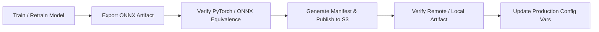

# EggVision Model Artifact Operations Manual

## 1. Overview & Operational Responsibilities

This manual specifies the operational procedures for managing, verifying, exporting, and publishing EggVision machine learning model artifacts across development, staging, and production environments.

---

## 2. Standard Operational Lifecycle



### Step 1: Export Detection Model to ONNX

Export the trained PyTorch checkpoint (`ml/artifacts/detection/weights/best.pt`) to static $640 \times 640$ ONNX format:

```powershell
# From repository root (in Python environment with torch, ultralytics, onnx)
python ml/scripts/export_detection_onnx.py `
  --pt-path ml/artifacts/detection/weights/best.pt `
  --output-dir ml/artifacts/detection/weights `
  --output-name eggvision_detector.onnx `
  --imgsz 640 `
  --opset 17 `
  --benchmark-runs 20
```

**Generated Artifacts:**
- `ml/artifacts/detection/weights/eggvision_detector.onnx`
- `ml/artifacts/detection/onnx_metadata.json`

### Step 2: Verify PyTorch vs ONNX Equivalence

Ensure that the exported ONNX model achieves numerical equivalence with PyTorch across the validation dataset:

```powershell
python ml/scripts/verify_onnx_equivalence.py `
  --pt-path ml/artifacts/detection/weights/best.pt `
  --onnx-path ml/artifacts/detection/weights/eggvision_detector.onnx `
  --val-images-dir data/curated/detection/val/images `
  --conf-threshold 0.25 `
  --iou-threshold 0.45 `
  --report-path ml/artifacts/detection/onnx_equivalence_report.json
```

**Success Criteria:**
- Exit code: `0`
- Status: `"PASSED_EQUIVALENT"`
- Mean IoU $\ge 0.90$
- Mean Confidence Difference $\le 0.03$
- $100\%$ detection count agreement on validation images

### Step 3: Publish Model Artifact to Object Storage

Upload the verified ONNX model and its cryptographic manifest to the dedicated models bucket:

```powershell
# Requires AWS / S3 credentials configured in environment
$env:MODEL_S3_ENDPOINT = "https://s3.us-east-1.amazonaws.com"
$env:MODEL_S3_BUCKET = "eggvision-models"
$env:MODEL_S3_ACCESS_KEY = "your-access-key"
$env:MODEL_S3_SECRET_KEY = "your-secret-key"
$env:MODEL_S3_REGION = "us-east-1"

python ml/scripts/publish_model_artifact.py `
  --onnx-path ml/artifacts/detection/weights/eggvision_detector.onnx `
  --metadata-path ml/artifacts/detection/onnx_metadata.json `
  --equivalence-report-path ml/artifacts/detection/onnx_equivalence_report.json `
  --version v1 `
  --output-dir ml/artifacts/detection
```

*Note: If S3 credentials are not set, the script executes in **offline mode**, generating `manifest.json` locally without attempting cloud network calls.*

### Step 4: Verify Artifact Integrity

Validate that a local or remote artifact matches its declared cryptographic signature and can be executed by ONNX Runtime:

```powershell
python ml/scripts/verify_model_artifact.py `
  --manifest ml/artifacts/detection/manifest.json `
  --local-path ml/artifacts/detection/weights/eggvision_detector.onnx
```

---

## 3. Artifact Key Specification

Model artifacts are stored under an immutable, content-addressed path:

```text
eggvision/detection/{version}/{sha256}/model.onnx
```

### Canonical Production Values (Phase 2 Release)
- **Version**: `v1`
- **SHA-256**: `81ee288a717ce922d195399244678d94596a6fab3adc4fc8a2eb46abf25678c1`
- **Canonical Key**:
  `eggvision/detection/v1/81ee288a717ce922d195399244678d94596a6fab3adc4fc8a2eb46abf25678c1/model.onnx`

---

## 4. Production Deployment Configuration (Render)

When updating the backend service on Render to serve the new model version, configure the following environment variables:

```bash
MODEL_VERSION="v1"
MODEL_ARTIFACT_KEY="eggvision/detection/v1/81ee288a717ce922d195399244678d94596a6fab3adc4fc8a2eb46abf25678c1/model.onnx"
MODEL_ARTIFACT_SHA256="81ee288a717ce922d195399244678d94596a6fab3adc4fc8a2eb46abf25678c1"
MODEL_S3_ENDPOINT="https://s3.us-east-1.amazonaws.com"
MODEL_S3_BUCKET="eggvision-models"
MODEL_S3_ACCESS_KEY="<production-models-s3-access-key>"
MODEL_S3_SECRET_KEY="<production-models-s3-secret-key>"
MODEL_S3_REGION="us-east-1"
```

---

## 5. Troubleshooting & Incident Runbook

### Incident: `MODEL_INTEGRITY_FAILED`
- **Symptoms**: `/api/v1/model/info` reports state `MODEL_INTEGRITY_FAILED`; `/predict` falls back to placeholder.
- **Root Cause**: The downloaded or local file SHA-256 does not match `MODEL_ARTIFACT_SHA256`.
- **Resolution**:
  1. Inspect the server log to see the computed hash vs expected hash.
  2. Verify that the file was not partially downloaded or corrupted in transit.
  3. Ensure `MODEL_ARTIFACT_SHA256` in Render environment matches the exact canonical SHA-256 of the artifact.
  4. Force a redeployment or clear the local model cache directory.

### Incident: Out of Memory on Cold Start
- **Symptoms**: Backend service restarts abruptly during startup.
- **Root Cause**: Memory limit exceeded during model loading.
- **Resolution**:
  1. Ensure PyTorch is **not** installed in the production backend container (`onnxruntime` uses $< 300\text{ MB}$ compared to $> 1.5\text{ GB}$ for PyTorch).
  2. Confirm intra-op threads in ONNX session options are set to 1 or 2 to avoid memory fragmentation.
