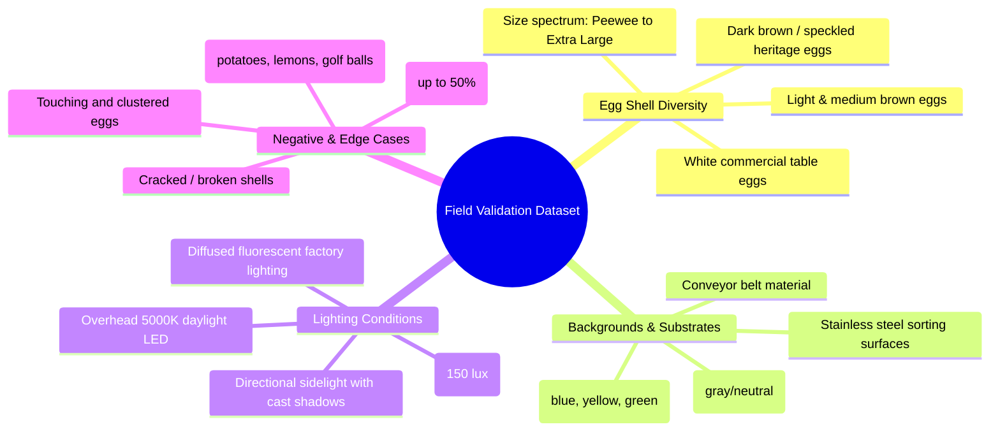

# EggVision Real-World Model Validation Protocol

## 1. Purpose & Scope

This protocol defines the formal testing procedure required to validate EggVision's computer vision and machine learning models prior to commercial production release. It establishes standards for dataset diversity, specimen partitioning, data leakage prevention, quantitative acceptance thresholds, and scientific reporting.

---

## 2. Dataset Diversity & Stratification Requirements

To guarantee model generalization across agricultural environments, validation batches must represent the full operational domain:



---

## 3. Specimen Partitioning & Leakage Prevention Protocol

Data leakage between training, validation, and test splits invalidates performance claims. The following protocol is strictly enforced:

1. **Specimen-Level Isolation**:
   - Each physical egg must be assigned a unique physical specimen identifier (e.g., `EGG-2026-FARM1-0042`).
   - If multiple images of the same egg are captured (e.g., rotated, altered angles, different lighting), **all images of that physical specimen must reside strictly in the same split** (100% in Train, 100% in Val, or 100% in Test).
2. **Farm / Batch Partitioning**:
   - Out-of-domain generalization must be evaluated on at least one test batch sourced from a farm facility completely absent from the training set.
3. **Cryptographic Manifest Verification**:
   - All dataset splits are recorded in a signed JSON manifest specifying filename, file size, and SHA-256 hash.
   - Any modification or substitution of an image invalidates the test set.

---

## 4. Annotation Standards

- **Format**: YOLO normalized coordinates:
  ```text
  <class_id> <x_center> <y_center> <width> <height>
  ```
- **Class Mapping**:
  - `0`: `egg`
- **Bounding Box Guidelines**:
  - Bounding boxes must fit tightly to the outer visible shell boundary.
  - Drop shadows, specular glare halos, and reflections on shiny surfaces must be excluded from the bounding box.
  - When an egg is partially occluded, the box should bound only the visible shell portion.

---

## 5. Quantitative Acceptance Criteria

A model artifact qualifies for production promotion only when meeting or exceeding the following benchmarks on the held-out real-world test set ($N \ge 200$ images):

| Metric | Target Standard | Evaluation Tool |
| :--- | :--- | :--- |
| **Precision ($P$) @ Conf 0.50** | $\ge 0.95$ | Ultralytics / PyCOCOtools |
| **Recall ($R$) @ Conf 0.50** | $\ge 0.95$ | Ultralytics / PyCOCOtools |
| **mAP@50** | $\ge 0.96$ | Ultralytics validation suite |
| **mAP@50-95** | $\ge 0.80$ | Ultralytics validation suite |
| **Tray Counting Accuracy** | $\ge 98.0\%$ agreement with ground truth | Count verification script |
| **False Positive Rate (Negatives)** | $< 1.0\%$ on non-egg distractors | Test report generator |
| **Inference Latency (CPU)** | $\le 75\text{ ms}$ per $640\times640$ frame | ONNX Runtime benchmark |

---

## 6. Scientific Disclosure & Non-Claims

> [!IMPORTANT]
> **Scientific Integrity Disclosure**
> - The EggVision Phase 2 detector is certified **strictly for visible shell detection and count localization**.
> - EggVision does **not** claim or infer internal albumen quality, yolk index, Haugh Units, bacterial contamination, or internal freshness via RGB camera capture.
> - Candling-based freshness evaluation requires dedicated optical transmission hardware and multi-spectral transillumination, which are independent hardware modules outside the scope of this detector.
