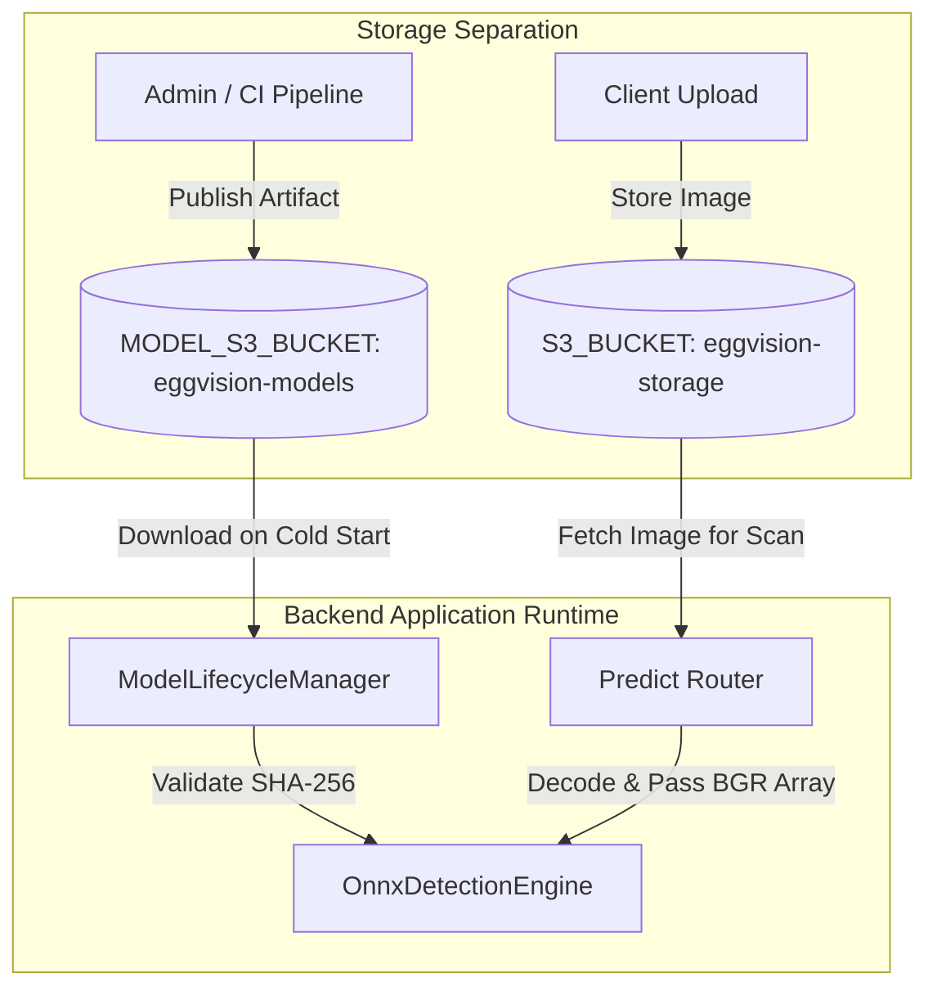
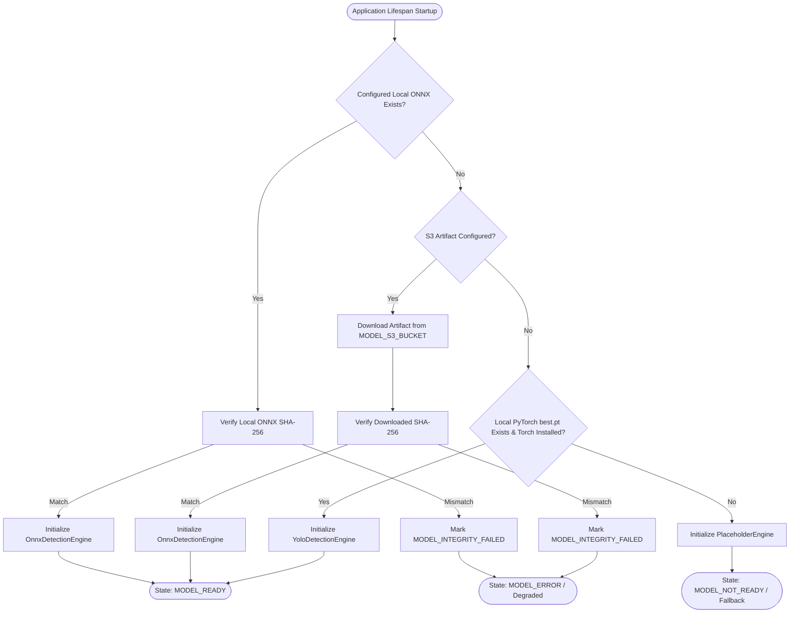
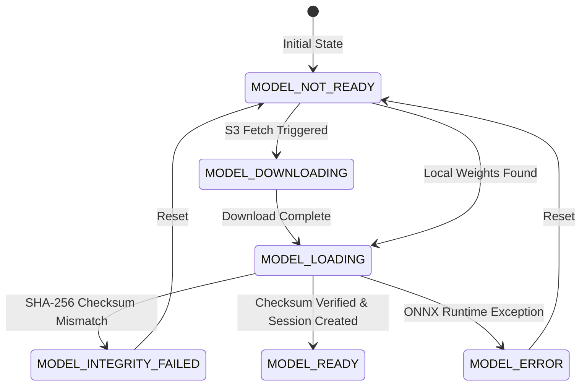

# EggVision Phase 2 — Model Artifact & Inference Architecture

## 1. Executive Summary

EggVision Phase 2 transitions the application from a training-time research checkpoint to a production-ready, verifiable ONNX Runtime inference architecture. This architecture decouples heavy training dependencies (PyTorch, Ultralytics, CUDA) from lightweight production serving environments, enforces cryptographic integrity verification on model weights, and provides robust local-to-remote resolution with safe fallback mechanisms.

---

## 2. Model Storage & Artifact Topology

To maintain least-privilege access and isolation between user data and internal ML assets, object storage is divided into two distinct logical buckets:

| Parameter | Application Object Storage (`S3_BUCKET`) | Model Weights Storage (`MODEL_S3_BUCKET`) |
| :--- | :--- | :--- |
| **Purpose** | Uploaded user egg images, inspection thumbnails, reports | Versioned ONNX model binaries and cryptographic manifests |
| **Lifecycle** | Dynamic, user-managed, subject to retention policies | Immutable, versioned, write-once / read-many |
| **Access Pattern** | Authenticated user reads/writes via application backend | Read-only at application boot (with fallback to local disk) |
| **Default Bucket** | `eggvision-storage` | `eggvision-models` |
| **Path Structure** | `uploads/{scan_id}/{filename}` | `eggvision/detection/{version}/{sha256}/model.onnx` |

---

## 3. Local Resolution & Startup Hierarchy

The backend loads inference models deterministically according to the following resolution cascade:

1. **Local Validated ONNX**: Checks `MODEL_LOCAL_PATH` (defaults to `ml/artifacts/detection/weights/eggvision_detector.onnx`). If present, computes SHA-256 against expected hash.
2. **S3 Artifact Download**: If local file is missing and `MODEL_S3_BUCKET` + `MODEL_ARTIFACT_KEY` are configured, downloads the ONNX model to local cache and verifies SHA-256 before loading.
3. **Local PyTorch Fallback**: If ONNX is absent but `best.pt` exists and PyTorch/Ultralytics are installed, loads `YoloDetectionEngine`.
4. **Safe Placeholder Fallback**: If no weights or ML runtime dependencies are available, activates `PlaceholderEngine` to ensure backend APIs remain responsive without crashing.

---

## 4. ModelLifecycleManager State Machine

The model manager tracks runtime readiness through an explicit state machine:

- **`MODEL_NOT_READY`**: No weights loaded; system serves degraded responses via placeholder.
- **`MODEL_DOWNLOADING`**: Actively fetching artifact from S3.
- **`MODEL_LOADING`**: File on disk; calculating SHA-256 and creating inference session.
- **`MODEL_INTEGRITY_FAILED`**: Cryptographic hash does not match `MODEL_ARTIFACT_SHA256`. Loading aborted to protect against corrupted or tampered models.
- **`MODEL_READY`**: Verified ONNX Runtime session active and ready for low-latency inference.
- **`MODEL_ERROR`**: Model corrupted or runtime environment incompatible.

---

## 5. OnnxDetectionEngine Preprocessing & Postprocessing Pipeline

The ONNX engine operates independently of Ultralytics and PyTorch, implementing a pure NumPy and OpenCV pipeline:

```mermaid
flowchart LR
    A[Input Image BGR HxWxC] --> B[Letterbox Pad to 640x640]
    B --> C[Convert BGR to RGB]
    C --> D[Normalize 0.0 - 1.0]
    D --> E[Transpose to BCHW 1x3x640x640]
    E --> F[ONNX Runtime Session CPU]
    F --> G[Raw Tensor 1x5x8400]
    G --> H[Transpose & Filter by Conf]
    H --> I[Rescale Boxes to Original HxW]
    I --> J[Non-Maximum Suppression IoU]
    J --> K[EggDetectionResult Detections]
```

### Preprocessing Specifications
- **Input Dimensions**: Static $640 \times 640$ pixels.
- **Aspect Ratio**: Preserved using center letterboxing with constant padding (`pad_value = (114, 114, 114)`).
- **Scale Factor**: $r = \min(640 / H, 640 / W)$.
- **Padding Offsets**: $pad_x = (640 - W \cdot r) / 2$, $pad_y = (640 - H \cdot r) / 2$.
- **Color Format**: BGR to RGB conversion.
- **Normalization**: Pixel values scaled to $[0.0, 1.0]$ via standard division by $255.0$.

### Output Tensor Parsing & NMS
- **Raw Output Shape**: `[1, 5, 8400]` representing batch size 1, 5 channels ($x_c, y_c, w, h, \text{confidence}_{\text{egg}}$), and 8,400 candidate anchor locations.
- **Candidate Transposition**: Transposed to `[8400, 5]` for vector operations.
- **Confidence Filter**: Candidates with $\text{confidence} < \text{conf\_threshold}$ (default $0.25$) are discarded.
- **Coordinate Conversion**: Center-based coordinates $(x_c, y_c, w, h)$ are mapped back to original image space:
  $$x_1 = (x_c - w/2 - pad_x) / r, \quad y_1 = (y_c - h/2 - pad_y) / r$$
  $$x_2 = (x_c + w/2 - pad_x) / r, \quad y_2 = (y_c + h/2 - pad_y) / r$$
- **NMS**: Multiclass Non-Maximum Suppression with IoU threshold $0.45$ removes redundant overlapping bounding boxes.

---

## 6. Runtime Configuration Reference

| Environment Variable | Type | Default | Description |
| :--- | :--- | :--- | :--- |
| `MODEL_VERSION` | string | `v1` | Semantic version string of active model |
| `MODEL_ARTIFACT_KEY` | string | `eggvision/detection/v1/81ee288a717ce922d195399244678d94596a6fab3adc4fc8a2eb46abf25678c1/model.onnx` | S3 key pointing to canonical ONNX artifact |
| `MODEL_ARTIFACT_SHA256` | string | `81ee288a717ce922d195399244678d94596a6fab3adc4fc8a2eb46abf25678c1` | Cryptographic SHA-256 hash required for integrity verification |
| `MODEL_S3_ENDPOINT` | string | `""` | Custom S3 / MinIO endpoint URL for model bucket |
| `MODEL_S3_BUCKET` | string | `eggvision-models` | Target bucket containing model artifacts |
| `MODEL_S3_ACCESS_KEY` | string | `""` | S3 access key with read permission on model bucket |
| `MODEL_S3_SECRET_KEY` | string | `""` | S3 secret key with read permission on model bucket |
| `MODEL_S3_REGION` | string | `us-east-1` | AWS region of model bucket |
