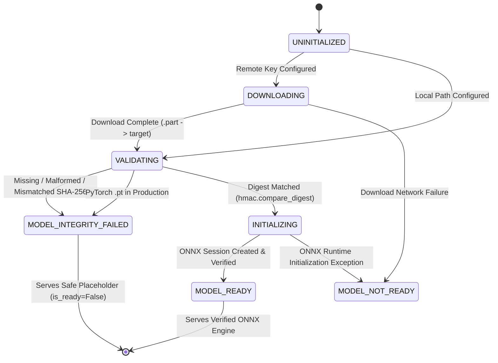
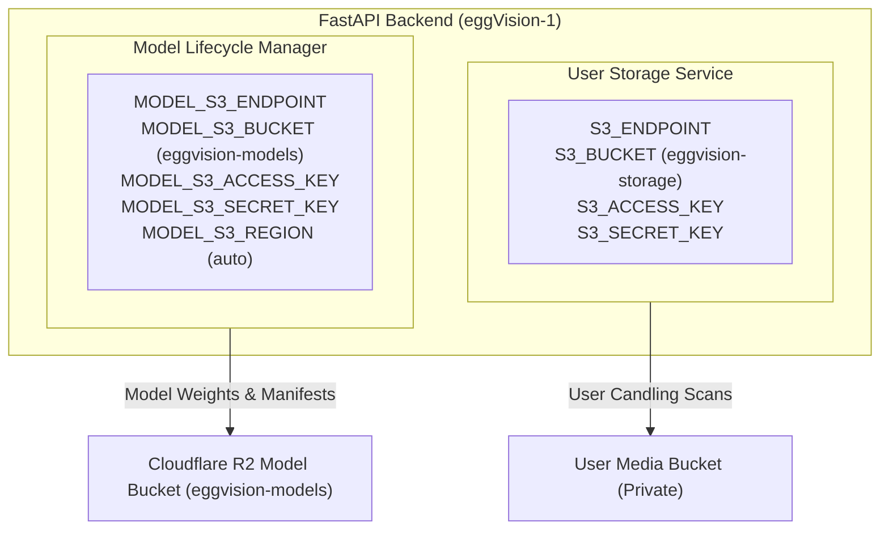

# EggVision AI — Phase 3 Implementation Report
## Artifact Integrity Hardening, Cloudflare R2 Runtime & Production Reliability

**Repository:** `https://github.com/Rishit-ui/eggVision`  
**Base Commit:** `20dc3630d3a1d2e8a194b07256673642cc995d8c`  
**Feature Branch:** `codex/phase3-artifact-integrity-r2`  
**Classification:** MLOps & Production Infrastructure Engineering Audit  

---

## 1. Executive Summary

Phase 3 transitions EggVision AI's model lifecycle from a permissive local/remote loading pattern into an immutable, cryptographic content-addressed runtime architecture. 

### Key Engineering Accomplishments:
1. **Mandatory Cryptographic Integrity Verification:**
   - Strict 64-character lowercase hex SHA-256 validation enforced before any model byte is touched by ONNX Runtime.
   - Any missing, malformed, or mismatched SHA-256 immediately transitions the model manager to `MODEL_INTEGRITY_FAILED` and halts inference initialization.
   - Constant-time digest comparison (`hmac.compare_digest`) prevents timing side-channel analysis.
2. **Strict Production PyTorch Rejection:**
   - Production environments (`APP_ENV=production`) reject PyTorch `.pt` artifacts at both startup and runtime to guarantee that heavy PyTorch/CUDA libraries cannot cause Out-Of-Memory (OOM) crashes on constrained infrastructure (512 MB – 1 GB Render instances).
3. **Storage Namespace Isolation:**
   - Model artifact operations strictly isolate `MODEL_S3_*` configuration. Model operations never inherit or fall back to application user-image storage credentials (`S3_*`), eliminating privilege escalation and blast-radius crossover.
4. **Cloudflare R2 Compatibility:**
   - Native support for Cloudflare R2 object storage with automatic region detection (`auto`), AWS Signature Version 4 (`s3v4`), and distinguished handling of 404/NotFound versus 403 Forbidden/network errors.
5. **Content-Addressed Atomic Runtime Caching:**
   - Models downloaded from remote S3/R2 are staged in a `.part` temporary file and atomically moved to `<tempdir>/eggvision_models/<sha256>/model.onnx`.
   - Corrupt caches (size mismatch or digest discrepancy) are evicted automatically with safe fallback cleanup.
6. **Strict Manifest Schema & Equivalence Validation:**
   - Introduced `ml/inference/manifest_validator.py` with validation rules covering schema integrity, provenance timestamps, SHA-256 format, and required ONNX equivalence reports.
7. **Production Configuration Guardrails:**
   - `Settings` in `backend/app/config.py` enforces `MODEL_ARTIFACT_SHA256` whenever `MODEL_PATH` or `MODEL_ARTIFACT_KEY` is configured in production, rejecting startup if a `.pt` file is referenced.
8. **Test Coverage & Verification:**
   - 25 dedicated Phase 3 tests added; complete test suite passes at 170/170 tests with zero regressions.

---

## 2. Cryptographic Integrity & Lifecycle State Machine

### Lifecycle State Definitions:

| State | Readiness (`is_ready`) | Checksum Verified | Description |
| :--- | :--- | :--- | :--- |
| `UNINITIALIZED` | `false` | `false` | Manager has not completed startup routine. |
| `MODEL_READY` | `true` | `true` | Exact SHA-256 matched, valid session initialized, ready for live inference. |
| `MODEL_NOT_READY` | `false` | `false` | Artifact missing, remote download failed, or ONNX runtime failure. |
| `MODEL_INTEGRITY_FAILED` | `false` | `false` | SHA-256 missing, malformed, or mismatched; `.pt` passed in production. |

---

## 3. Storage Architecture: Cloudflare R2 vs Application Storage

To preserve strict security boundaries, model artifacts and user upload images use completely independent configuration keys:

### Endpoint & Credential Rules:
1. `MODEL_S3_BUCKET` defaults to `"eggvision-models"`.
2. `MODEL_S3_REGION` defaults to `"auto"` when interacting with Cloudflare R2 (`*.r2.cloudflarestorage.com`).
3. Model loaders, publishers, and verifiers raise `ValueError` or fallback safely to offline local manifests if `MODEL_S3_*` credentials are absent, rather than reading `S3_*`.

---

## 4. Content-Addressed Atomic Runtime Cache

When remote artifact download is triggered:
1. Target directory is derived from the expected hash: `<tempdir>/eggvision_models/<sha256>/model.onnx`.
2. If file exists, its SHA-256 and size are re-verified. If valid, remote download is bypassed entirely (instant warm start).
3. If corrupt or missing, remote artifact is streamed into a transient `.part` file: `<tempdir>/eggvision_models/<sha256>/model.onnx.<uuid>.part`.
4. Once completed, SHA-256 is validated against expected digest.
5. If valid, the file is atomically renamed via `os.replace` to `model.onnx`.
6. If invalid, the `.part` file is deleted immediately and `MODEL_INTEGRITY_FAILED` is raised.

---

## 5. Automated Test Suite Results

The Phase 3 test suite (`tests/ml/test_phase3_artifact_integrity_r2.py`) was executed using Python 3.12:

| Test Group | Tests | Result | Notes |
| :--- | :--- | :--- | :--- |
| `TestArtifactIntegrityValidation` | 10 | **PASSED** | Verifies `None`, empty string, spaces, short hash, invalid hex chars, 63-char, 65-char digests rejected; matching digest loads; `.pt` in production rejected |
| `TestProductionSettingsConstraints` | 3 | **PASSED** | Verifies production settings enforce SHA-256 for local & S3 paths, prohibit `.pt` |
| `TestPredictionServiceSafety` | 1 | **PASSED** | Verifies PredictionService never falls back to unverified or second model |
| `TestLocalArtifactVerification` | 1 | **PASSED** | Verifies CLI tool rejects verification without expected digest |
| `TestStorageNamespaceSeparation` | 3 | **PASSED** | Confirms loader, publisher, and verifier ignore `S3_*` settings |
| `TestCloudflareR2Configuration` | 1 | **PASSED** | Confirms R2 endpoint sets region to `auto` and uses `s3v4` |
| `TestManifestValidationAndPublisherHardening` | 5 | **PASSED** | Confirms schema validation, equivalence report requirement, and 403 error propagation |
| `TestContentAddressedCacheReliability` | 1 | **PASSED** | Confirms `.part` download, cache reuse, and atomic movement |
| **Total Test Suite** | **170** | **ALL PASSED** | Combined backend, ML foundation, Phase 2, and Phase 3 suites |

---

## 6. Review & Deployment Instructions

1. **Review Only:** PR is provided for manual code review and must not be auto-merged.
2. **Deployment Guardrail:** Do not configure R2 environment variables on Render until the Cloudflare R2 bucket and token permissions are established according to [EGGVISION_CLOUDFLARE_R2_SETUP.md](file:///c:/Users/Rishit/OneDrive/Desktop/eggVision/docs/EGGVISION_CLOUDFLARE_R2_SETUP.md).
