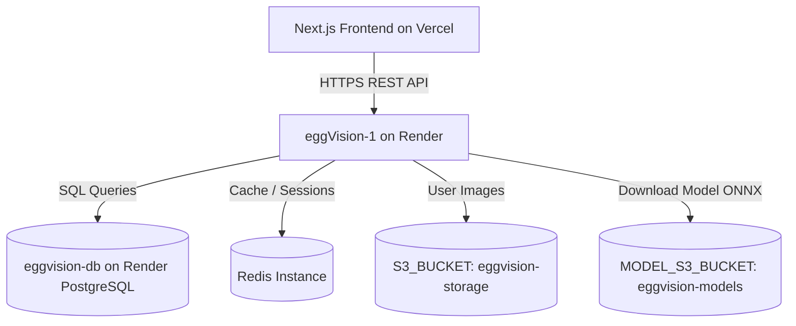

# EggVision Render Deployment & Resource Requirements

## 1. Production Architecture Overview

The EggVision production backend is hosted on Render under the service name `eggVision-1`. It runs a FastAPI application behind Uvicorn and connects to an external PostgreSQL instance and S3-compatible object storage.



---

## 2. Resource Sizing & Memory Benchmark

### Memory Footprint Breakdown

| Component | Estimated Resident Memory (RSS) | Notes |
| :--- | :--- | :--- |
| **Python 3.11 Runtime + Uvicorn** | $120\text{ MB} - 160\text{ MB}$ | Base FastAPI application with SQLAlchemy and route handlers |
| **ONNX Runtime Engine** | $150\text{ MB} - 220\text{ MB}$ | In-memory session, weights graph, scratch buffer |
| **Image Processing (OpenCV / Pillow)** | $30\text{ MB} - 60\text{ MB}$ | Temporary buffer during $640\times640$ letterboxing and decoding |
| **Peak Total Consumption** | **$\sim 300\text{ MB} - 440\text{ MB}$** | Single concurrent inference request |

### Plan Comparison & Recommendations

| Tier | Memory Limit | Feasibility for ONNX Runtime | Recommendation |
| :--- | :--- | :--- | :--- |
| **Free Tier** | $512\text{ MB}$ | **Marginal** ($\sim 80\text{ MB}$ buffer remaining). High risk of OOM restart during concurrent image uploads or spike traffic. | Development & testing only. |
| **Starter Tier** ($7/mo) | $1,024\text{ MB}$ ($1\text{ GB}$) | **Optimal**. Ample headroom for concurrent requests and multi-worker Uvicorn. | **Recommended for production.** |

> [!WARNING]
> **Strict Dependency Rule**
> Under no circumstances should `torch`, `torchvision`, or `ultralytics` be added to `backend/requirements.txt`. PyTorch alone consumes $> 1.2\text{ GB}$ of RAM at import time, which guarantees immediate OOM crashes on the 512 MB Render Free tier. Only `onnxruntime` is approved for the backend serving layer.

---

## 3. Required Production Environment Variables

Add the following environment variables to the `eggVision-1` dashboard on Render:

```bash
# Model Runtime Settings
MODEL_VERSION="v1"
MODEL_ARTIFACT_KEY="eggvision/detection/v1/81ee288a717ce922d195399244678d94596a6fab3adc4fc8a2eb46abf25678c1/model.onnx"
MODEL_ARTIFACT_SHA256="81ee288a717ce922d195399244678d94596a6fab3adc4fc8a2eb46abf25678c1"

# Model S3 Storage
MODEL_S3_ENDPOINT="https://s3.us-east-1.amazonaws.com"
MODEL_S3_BUCKET="eggvision-models"
MODEL_S3_ACCESS_KEY="<production-models-s3-access-key>"
MODEL_S3_SECRET_KEY="<production-models-s3-secret-key>"
MODEL_S3_REGION="us-east-1"
```

---

## 4. CRITICAL: Database Backup & Expiry Runbook

> [!CAUTION]
> **Action Required: Database Expiry on 28 November 2026**
> Render free PostgreSQL databases expire exactly 30 days after creation. The current database `eggvision-db` is scheduled for deletion on **28 November 2026**. Follow this runbook to prevent permanent data loss.

### Step 1: Export Complete Database Dump
Execute `pg_dump` from an authorized workstation with PostgreSQL client tools:

```bash
pg_dump "$DATABASE_URL" \
  --format=custom \
  --no-owner \
  --no-privileges \
  --file="eggvision_db_backup_$(date +%Y%m%d_%H%M%S).dump"
```

### Step 2: Validate the Backup Archive
Verify that the dump contains all schemas, tables, and migration revisions:

```bash
pg_restore --list eggvision_db_backup_*.dump | grep -E "alembic_version|scans|predictions|users"
```

### Step 3: Restore to a New Managed Instance
1. Provision a new PostgreSQL instance on Render or an external managed provider.
2. Restore the dump into the new target database:
   ```bash
   pg_restore \
     --dbname="$NEW_DATABASE_URL" \
     --clean \
     --if-exists \
     --no-owner \
     --no-privileges \
     eggvision_db_backup_*.dump
   ```
3. Update `DATABASE_URL` in the `eggVision-1` environment settings and redeploy.
