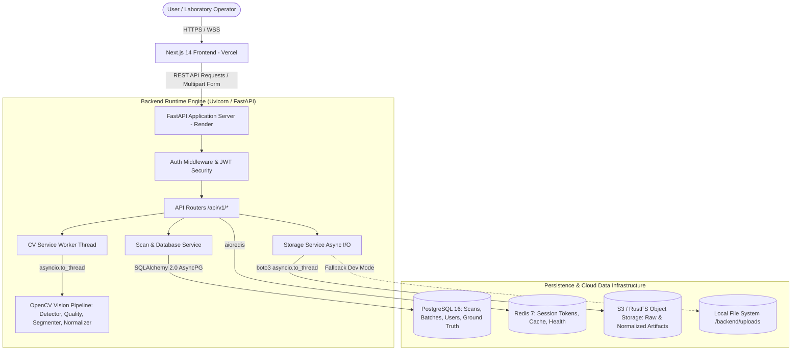
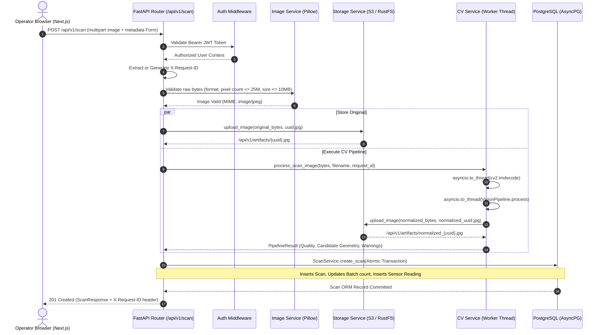

# EggVision AI — System Architecture Specification
**Document Version:** 1.0.0  
**Status:** Implemented & Verified Baseline  
**Classification:** Technical Architecture & Design Document

---

## 1. Executive Architecture Summary

EggVision AI is an end-to-end, non-destructive poultry egg research and candling capture-assessment platform. The system integrates controlled optical hardware enclosure specifications, a deterministic Computer Vision (CV) screening engine, asynchronous FastAPI web services, PostgreSQL relational storage with Alembic schema management, Redis caching and session support, S3/RustFS-compatible object storage, and a responsive Next.js 14 frontend application.

---

## 2. Architectural Principles & Invariants

1. **Deterministic Separation of Capture Screening vs. Machine Learning Inference**:
   - The Computer Vision pipeline (`ml/vision/`) performs deterministic boundary screening, exposure analysis, glare checks, blur assessment, and optical normalization.
   - It **never** fabricates AI predictions, confidence percentages, or freshness classifications.
   - The ML inference subsystem (`ml/inference/`) remains decoupled via an abstract `InferenceEngine` interface; in the absence of validated checkpoint weights, it transparently returns `MODEL_NOT_READY` (`is_ready() == False`).

2. **Non-Blocking Asynchronous Concurrency**:
   - CPU-bound OpenCV computations (Otsu thresholding, contour morphometrics, JPEG canonical encoding) are offloaded from the main asyncio event loop using `asyncio.to_thread()`.
   - Network I/O (S3 upload/download, PostgreSQL queries) executes asynchronously via non-blocking drivers (`asyncpg`, `aiofiles`, threadpool-backed boto3).

3. **Transactional Integrity & Compensation**:
   - The scan ingestion path executes database mutations (scan record creation, batch counter increments, sensor reading attachments) within a single atomic SQLAlchemy transaction. If any database write fails, the entire transaction is rolled back.

4. **Security & Zero Information Leakage**:
   - No raw exception traces, database credentials, JWT secrets, image byte dumps, or client filenames are logged.
   - Every scan request assigns and returns a unique, sanitized `X-Request-ID` correlation header for end-to-end auditability.

---

## 3. Component Architecture & Directory Decomposition

### 3.1 Backend Application (`backend/app/`)
- `main.py`: Application factory, CORS middleware configuration, lifespan management (database warmup, storage bucket readiness, clean shutdown).
- `config.py`: Pydantic `BaseSettings` declaring environment variables, port bindings, timeouts, and production validators (e.g. enforcing strict non-wildcard CORS, mandatory strong JWT secrets).
- `database.py`: SQLAlchemy asynchronous engine, session factory (`async_sessionmaker`), and graceful connection teardown.
- `routers/`: Modular route controllers:
  - `scan.py`: Multi-part scan intake, validation, storage coordination, CV execution, structured timing logging.
  - `predict.py`: Inference request router (honestly abstains when model is unready).
  - `result.py`: Retrieval of scan details, dynamic gating flags, and candidate contours.
  - `history.py`: Paginated scan history with joined prediction records.
  - `health.py`: Deep health check inspecting Database, Redis, Object Storage, and ML Engine statuses independently.
  - `auth.py`: JWT-based user login, token refresh, and bootstrap initialization.
  - `artifacts.py`: Authenticated proxy for protected artifact streaming.
  - `batch.py`, `dashboard.py`, `analytics.py`, `research.py`, `model_info.py`.
- `services/`: Business logic layer (`cv_service.py`, `scan_service.py`, `storage_service.py`, `image_service.py`).
- `models/`: SQLAlchemy 2.0 mapped models (`Scan`, `Prediction`, `Batch`, `User`, `SensorReading`, `GroundTruth`, `AuditLog`, `Device`, `Farm`, `ModelVersion`).
- `schemas/`: Pydantic V2 data contracts (`ScanCreate`, `ScanResponse`, `PredictionResponse`, etc.).

### 3.2 Machine Learning & Vision Library (`ml/`)
- `vision/detector.py`: Dual-mode candidate contour screener (`controlled_candling` dark-border separation and `general_photograph` LAB color contrast screening).
- `vision/quality.py`: Region-of-Interest (ROI) optical quality assessor (detecting blur, candidate glare, shadows, clipping, and framing).
- `vision/segmentation.py`: Morphometric feature extractor (calculating area, bounding rectangle, aspect ratio, orientation angle, centroid).
- `vision/normalizer.py`: Optical canonicalizer (standardizing image dimensions to 512x512, histogram equalization, CLAHE enhancement).
- `vision/pipeline.py`: Pipeline orchestrator unifying detection, quality gating, segmentation, and normalization into a `PipelineResult`.
- `inference/engine.py`: Abstract `InferenceEngine` ABC, `ModelInfo`, and `PredictionResult` data structures.
- `inference/placeholder.py`: `PlaceholderEngine` returning honest `MODEL_NOT_READY` status.

### 3.3 Frontend Application (`frontend/src/`)
- Modern React 18 / Next.js 14 App Router application styled with Tailwind CSS and Radix UI components (`shadcn/ui`).
- `src/lib/api.ts`: Centralized, robust API client with bounded 20s timeouts, bearer token injection, discrete HTTP error mapping (401, 403, 413, 422, 502, 503, 504), and browser-native multipart boundary preservation.
- `src/app/scan/page.tsx`: Interactive candling capture console with drag-and-drop upload, client-side preview, metadata inputs (egg type, storage conditions, temperature, humidity), capture-screening quality issue badge display, and automatic retake recommendation flows.
- `src/app/result/[id]/page.tsx`: Transparent research capture report presenting candidate contour geometry, optical quality indicators, and explicit notices regarding unvalidated ML predictions.
- `src/app/dashboard/`, `src/app/history/`, `src/app/batch/`, `src/app/analytics/`, `src/app/admin/`, `src/app/login/`.

---

## 4. End-to-End Scan Data Flow

The following sequence diagram details the end-to-end execution of a protected egg candling scan submission:

---

## 5. Reliability & Error Recovery Matrix

| Fault Point | Detection Mechanism | Immediate Action | HTTP Status Code | User-Facing Guidance |
| :--- | :--- | :--- | :--- | :--- |
| **Malformed Image File** | Pillow `Image.open()` failure | Reject upload | `400 Bad Request` | "The uploaded file could not be parsed as a valid image." |
| **Oversized Upload** | Byte buffer length > 10MB | Reject upload | `413 Payload Too Large` | "The selected image is too large. Maximum size is 10 MB." |
| **Original Storage Unavailable** | `BotoCoreError`, `ClientError`, `OSError` | Log exception, abort | `502 Bad Gateway` | "Image storage is temporarily unavailable. Please try again." |
| **CV Pipeline Exception** | `Exception` inside worker thread | Server-side trace | `502 Bad Gateway` | "Image processing failed. Please try again." |
| **Normalized Storage Failed** | Boto3 upload failure in worker | Abort pipeline | `502 Bad Gateway` | "Processed image storage is temporarily unavailable." |
| **PostgreSQL Write Failure** | `SQLAlchemyError` during commit | `db.rollback()` | `503 Service Unavailable` | "Scan persistence is temporarily unavailable. Please try again." |
| **Unready AI Model** | `PlaceholderEngine.is_ready() == False` | Return honest state | `200 OK` (Predict) | Transparently reports `model_not_ready`; no fake numbers. |
