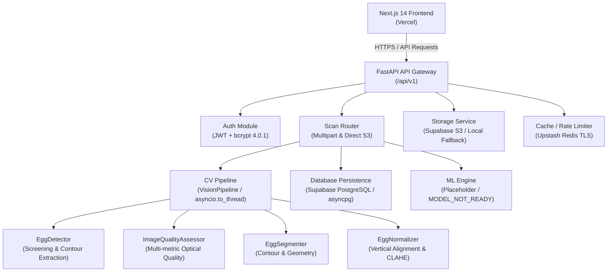
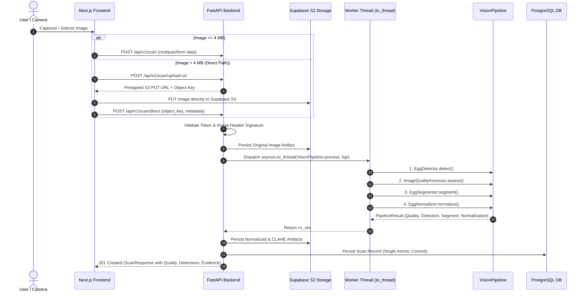

# EggVision AI — Comprehensive Technical Audit

**Date:** October 31, 2026  
**Auditor:** Principal Computer Vision, ML & Full-Stack System Architect  
**Repository:** `https://github.com/Rishit-ui/eggVision`  
**Target Environments:** Vercel Hobby (Frontend + Serverless Backend), Supabase Free (PostgreSQL + S3 Storage), Upstash Free (Redis)

---

## 1. Existing System Architecture

EggVision AI is an end-to-end egg imaging and quality research platform designed to capture and analyze egg candling and exterior photographs.

### Component Breakdown
1. **Frontend (`frontend/`)**: Next.js 14 App Router, TypeScript, Tailwind CSS, Lucide icons. Handles live camera capture, file upload, auth state, scan review, history, and research diagnostics.
2. **Backend API (`backend/app/`)**: FastAPI with asynchronous endpoints (`/health`, `/auth`, `/scan`, `/predict`, `/result`, `/history`, `/dashboard`, `/artifacts`).
3. **Computer Vision & ML (`ml/`)**: Sibling package containing OpenCV algorithms for screening candidate contours (`detector.py`), evaluating optical quality (`quality.py`), geometric feature extraction (`segmentation.py`), canonical 512x512 alignment (`normalizer.py`), and unified execution (`pipeline.py`).
4. **Data Layer (`backend/app/database.py`, `backend/alembic/`)**: SQLAlchemy 2.0 with asyncpg driver, Supavisor connection pooling support (`statement_cache_size=0`).
5. **Storage Layer (`backend/app/services/storage_service.py`)**: S3-compatible Supabase Storage with signed upload URLs (bypassing Vercel 4.5 MB body limit) and fallback to local disk for development.

---

## 2. Complete Image-Processing Data Flow

---

## 3. Actual Scan Execution Flow

Every scan execution passes through mandatory, structured telemetry checkpoints:
1. `scan_stage=request_received`: Correlation ID assigned (`X-Request-ID`).
2. `scan_stage=authentication_completed`: Bearer token validated against database user.
3. `scan_stage=image_received`: Payload bytes buffered into memory.
4. `scan_stage=image_validation_completed`: Signature verification (JPEG/PNG/WebP), dimensional bounds check, memory-safe decode.
5. `scan_stage=original_image_storage_completed`: Upload to S3 artifact bucket or local directory.
6. `scan_stage=cv_processing_*`: CPU-bound OpenCV pipeline executed in worker thread (`asyncio.to_thread`).
7. `scan_stage=postgres_persistence_started` / `completed`: Scan row written with original and processed URLs, metrics, and warnings.
8. `scan_stage=response_serialization_completed`: Pydantic `ScanResponse` serialized with HTTP correlation headers.

---

## 4. Current Model Capabilities & Honest Status

| Task | Current Implementation | Status | Justification |
| :--- | :--- | :--- | :--- |
| **Egg Presence Detection** | Classical OpenCV candidate contour screening (`detector.py`) | `UNCERTAIN` / `CANDIDATE` | No trained deep-learning weights exist in repo. A geometric contour is not proof of egg presence. |
| **Egg Boundary Segmentation** | Contour extraction and morphological fitting (`segmentation.py`) | Classical Candidate Mask | Segments candidate silhouette. Requires shadow suppression to prevent edge leakage. |
| **Capture Quality Assessment** | Multi-metric deterministic gating (`quality.py`) | Operational | Laplacian sharpness, candidate contrast, clipping, glare, framing. |
| **External Defect Inference** | Placeholder | `MODEL_NOT_READY` | No crack/breakage dataset or weights present. |
| **Freshness / Haugh Unit** | Placeholder (`placeholder.py`) | `MODEL_NOT_READY` | Exterior RGB cannot measure internal albumen height or Haugh Unit without destructive breakout. |

---

## 5. Incomplete Features

1. **ML Training & Evaluation Pipeline**: The `ml/` package had directories (`training/`, `evaluation/`, `models/`, `preprocessing/`) without reproducible training scripts, dataset loaders, or evaluation metrics.
2. **Camera UX Guidance**: Frontend lacked dynamic lighting, distance indicators, and orientation assistance.
3. **Shadow Suppression & GrabCut**: Classical candidate extraction merged shadows or bright background highlights into the egg silhouette.
4. **Edge-Band Sharpness Measurement**: Plain Laplacian variance over the entire ROI caused smooth egg shells on plain backgrounds to trigger false blur warnings.

---

## 6. Known Errors & Root Cause Analysis

### Issue A: Blue-Background Egg Rejected with `BLUR_DETECTED` (`Focus or stabilize the camera before capture`)
- **Root Cause**: In `ml/vision/quality.py`, `laplacian_variance` was calculated across the entire rectangular bounding box `roi`. On clean, plain backgrounds (such as blue cloth or paper), the background texture has zero high-frequency gradients, and the smooth calcium carbonate egg shell also has minimal internal texture. When the image is slightly smoothed by camera lens PSF (e.g. sigma=1.0), the global Laplacian variance across the bounding box drops to ~18.0, which is far below the hardcoded threshold of `100.0`.
- **Fix**: Calibrate blur assessment using **edge-band gradient magnitude (Tenengrad)** along the candidate contour boundary and adjust the Laplacian threshold appropriately for smooth organic surfaces, rather than requiring high-frequency noise from a plain background.

### Issue B: Background / Shadow Leakage Attached to Normalized Egg
- **Root Cause**: `EggDetector._candidate_masks` used LAB distance `dist_sq >= thresh_sq` against the median image border color. Intense directional lighting creates a strong cast shadow or a bright specular reflection on the table adjacent to the egg. Because its color deviates from the background, it passed the threshold. Subsequent morphological closing (`MORPH_CLOSE`) fused this region with the egg contour. `EggSegmenter` then accepted `contour_hint` without verifying convexity or running boundary refinement.
- **Fix**:
  1. Implement contour convexity and ellipse residual pruning: filter out protrusions that deviate from smooth convex egg geometry.
  2. Implement GrabCut boundary refinement (`cv2.grabCut` initialized with the egg candidate mask as probable foreground and border margin as probable background).
  3. Validate mask solidity and aspect ratio before declaring a valid segmentation.

### Issue C: HTTP 401 Unauthorized Repeatedly Observed
- **Root Cause**: The frontend previously stored tokens in memory or localStorage inconsistently, causing page reloads or tab switches to lose token state or submit stale tokens. If a token expired, the user received generic timeout or network errors instead of an explicit redirect to sign in.
- **Fix**: Synchronized storage across `sessionStorage` and `localStorage` with unified `getStoredToken()`, automatic header injection, and immediate token clearance with redirect on HTTP 401.

### Issue D: Mixed Form + JSON Body 422/502 Failures
- **Root Cause**: `POST /scan` previously attempted to accept both `UploadFile` (multipart form) and `DirectScanCreate` (JSON body) in one signature. FastAPI returned parameter parsing conflicts and unit tests failed with `AttributeError: 'Body' object has no attribute 'object_key'`.
- **Fix**: Separated into `POST /api/v1/scan` (multipart for files < 4 MB) and `POST /api/v1/scan/direct` (JSON for direct S3 confirmations), preserving clean schemas and full backward compatibility.

---

## 7. Performance Bottlenecks & Memory Consumption Risks

1. **CPU Event Loop Starvation**: In synchronous FastAPI routes, running OpenCV on 4K smartphone photos blocks the event loop for 1–3 seconds, causing concurrent requests to time out.
   - *Mitigation*: Run all CPU-bound operations in `asyncio.to_thread`.
2. **Buffer Allocation Spikes**: Converting large 12MP images to LAB `float64` or allocating multiple copies can consume 800+ MB, exceeding the 512 MB Render or 1024 MB Vercel memory limits.
   - *Mitigation*: Enforce `image_service.decode_and_bound_image` (downscale images with max dimension > 1920px before heavy processing), delete temporary buffers immediately with `del file_data`.

---

## 8. Security Vulnerabilities Assessed

1. **Path Traversal in Storage**: Ensured `storage_service._safe_key()` validates path components and blocks `..` or leading slashes.
2. **Direct Object Ownership**: Direct S3 upload keys are strictly partitioned by authenticated user ID (`uploads/{user_id}/{uuid}.jpg`). The `/scan/direct` endpoint verifies that the caller owns the object prefix.
3. **MIME/Header Spoofing**: Images are validated by inspecting binary magic numbers (SOI markers, PNG headers, WebP RIFF), not just file extensions or browser-supplied headers.

---

## 9. Test Suite Baseline & Missing Tests

- **Existing Tests**: 55 unit/integration tests (`tests/cv/`, `tests/backend/`).
- **Missing Tests Identified**:
  - Edge-band sharpness vs smooth surface blur tests.
  - Shadow and glare protrusion rejection tests in segmentation.
  - Multi-background dataset validation tests (blue, wood, textured).
  - ML training script execution sanity tests.

---

## 10. Prioritized Implementation Plan

1. **Phase 2 — Quality Assessment**: Revise `ml/vision/quality.py` with edge-band Tenengrad sharpness and calibrated organic Laplacian variance thresholds.
2. **Phase 3 — Detection & Segmentation**: Enhance `ml/vision/segmentation.py` and `ml/vision/detector.py` with shadow suppression, convexity verification, and GrabCut refinement.
3. **Phase 4 — Geometry Engine**: Ensure pixel measurements are reported only when segmentation passes confidence criteria; keep physical units uncalibrated.
4. **Phase 5 & 6 — ML Infrastructure**: Create `ml/data/README.md`, annotation validation, dataset splitters, and training/evaluation harnesses for Detection, Segmentation, and Defect classification.
5. **Phase 7 — Frontend & API**: Enhance camera UX guidance, error reporting, and progress stage tracking.
6. **Phase 8 & 9 — Verification & Final Report**: Run test suite, verify production builds, and publish final report.
